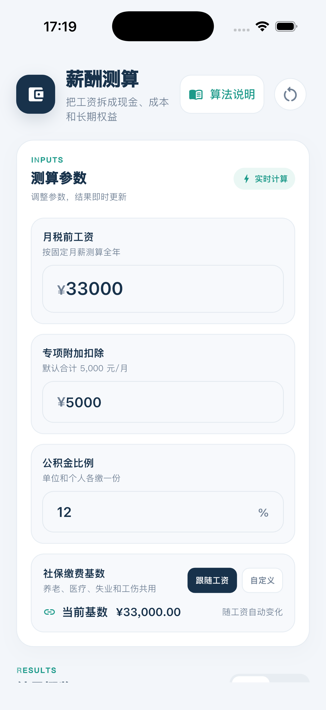

# 薪酬测算

一个基于 Flutter 的离线薪酬估算器，帮助你把固定月薪拆解为税后现金、单位用工成本和长期权益。支持 Android 与 iOS；无需注册或联网，测算参数保存在设备本地。

> 本项目用于薪酬方案估算和学习，不构成工资、税务或社保建议。示例费率不代表全国统一标准，计算结果不等同于正式工资单或税务申报结果。

## 运行截图

| 测算参数 | 全年结果 | 月度拆解（展开） | 算法说明 |
| --- | --- | --- | --- |
|  |  |  |  |

截图由 iPhone 17 模拟器实际运行应用后截取。

## 功能

- **即时薪酬测算**：编辑月税前工资、每月专项附加扣除、公积金比例和社保缴费基数，结果随输入更新。
- **灵活设置缴费基数**：社保基数可以跟随工资，也可以自定义；应用不会自动套用地区缴费上下限。
- **查看全年或逐月结果**：查看全年汇总或选择月份，包含个税、税后现金和权益变化；跨越个税档位的月份会特别标记。
- **折叠月度拆解**：默认以全年或当前所选月份作为预览；展开后查看 12 个月的个税、税后现金、权益和税档，并可点选月份切换结果。
- **拆解收入与缴费**：展开“计算依据”查看个人扣款、单位缴费、累计应税收入、预扣税额和权益组成。
- **对比两种权益口径**：权益 A 为税后现金加双边公积金和个人医疗缴费；权益 B 再加个人养老缴费。
- **离线使用并保存参数**：设置保存在设备本地，重新打开后继续使用；可恢复默认参数。
- **内置算法文档**：在应用中查看费率假设、累计预扣法、税率表、速算扣除数和适用范围。

## 默认测算方案

| 参数 | 默认值 |
| --- | ---: |
| 月税前工资 | ¥33,000 |
| 月专项附加扣除 | ¥5,000 |
| 社保缴费基数 | 跟随工资（¥33,000） |
| 公积金比例 | 12%（单位和个人各缴一份） |

固定月薪按完整 12 个月测算。默认参数下，全年单位成本为 **¥549,648.00**，全年税后现金为 **¥286,411.20**，全年权益 A 为 **¥389,371.20**，全年权益 B 为 **¥421,051.20**，全年预扣个税为 **¥20,452.80**。

## 计算口径与适用范围

应用采用固定的演示费率：单位养老 16%、医疗 9.8%、失业 0.5%、工伤 0.5%；个人养老 8%、医疗 2%、失业 0.5%。公积金按用户输入的比例由单位和个人各缴一份，个人缴费另含固定 ¥3/月的大病统筹示例值。社保险种使用同一个社保基数，公积金基数使用税前月工资。

个税按照每月 ¥5,000 基本减除费用和用户填写的专项附加扣除，使用居民个人工资薪金**累计预扣法**及年度预扣率表计算。默认 ¥5,000 专项附加扣除仅为示例输入，不是所有人的固定法定扣除额。

当前版本按同一单位、固定月薪、完整 12 个月估算，不包含年中调薪、奖金单独计税、入离职月份、多家单位、地区费率模板或社保缴费上下限校验。实际缴费和预扣税额会因地区、年度、个人情况及年度汇算而变化；请以主管部门规定和实际工资单为准。

## 开始使用

### 环境要求

- Flutter **3.38.0 或更新版本**（项目使用 Flutter 3.38.5 / Dart 3.10.4）
- Android：Android Studio、Android SDK 和 Java 21 工具链
- iOS：macOS、Xcode 和 CocoaPods

### 获取依赖并运行

```bash
git clone git@github.com:hc2088/pay_cal.git
cd pay_cal
flutter pub get
flutter run
```

也可以指定设备运行：

```bash
flutter run -d <device-id>
```

如果使用 FVM 管理 Flutter 版本：

```bash
fvm use 3.38.5
fvm flutter pub get
fvm flutter run
```

## 项目结构

```text
lib/
├── calculation/       # 输入模型、金额格式化和薪酬计算引擎
├── data/              # 本地参数存储
├── features/calculator/
│   ├── calculator_screen.dart    # 参数输入、结果和计算拆解
│   ├── methodology_screen.dart  # 应用内算法说明页
│   └── calculator_providers.dart
└── main.dart

doc/
├── 薪酬算法说明.md
├── 薪酬测算Flutter产品设计文档.md
└── 薪酬测算Flutter研发实现文档.md
```

算法细节请阅读[薪酬算法说明](doc/薪酬算法说明.md)，产品范围和交互见[产品设计文档](doc/薪酬测算Flutter产品设计文档.md)，技术实现见[研发实现文档](doc/薪酬测算Flutter研发实现文档.md)。

## 技术栈

- Flutter / Dart
- Riverpod：状态管理
- Shared Preferences：本地参数持久化
- Flutter Markdown Plus：渲染应用内算法说明

## 许可证

本项目采用 [MIT License](LICENSE)。第三方依赖仍遵循各自的许可证。
