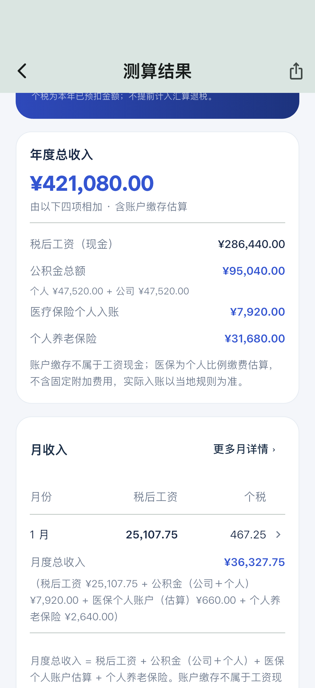
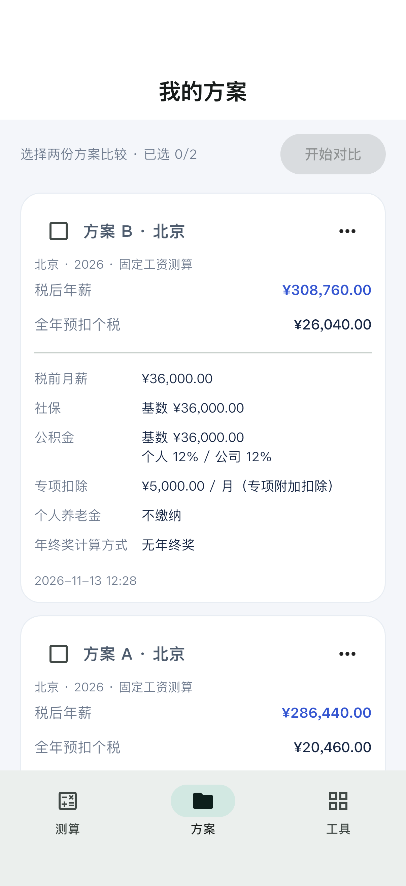
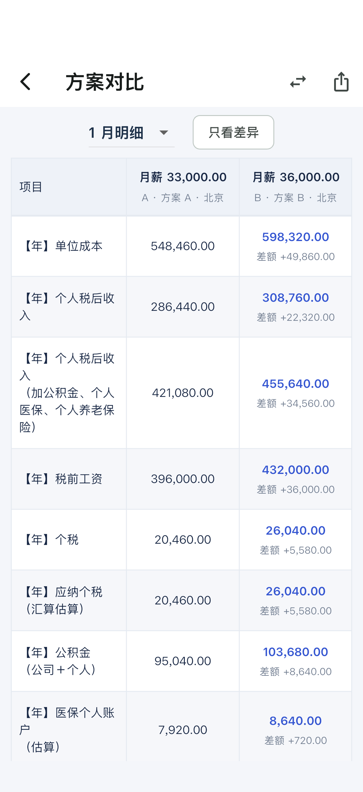
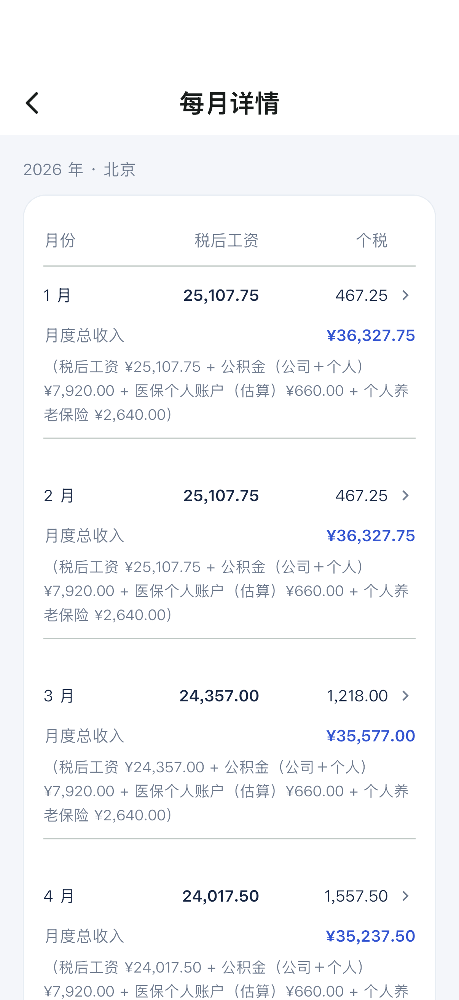
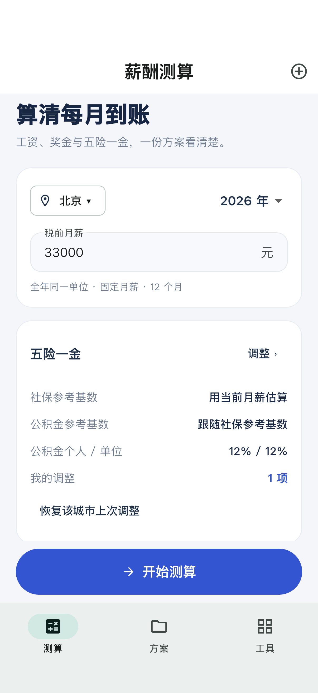
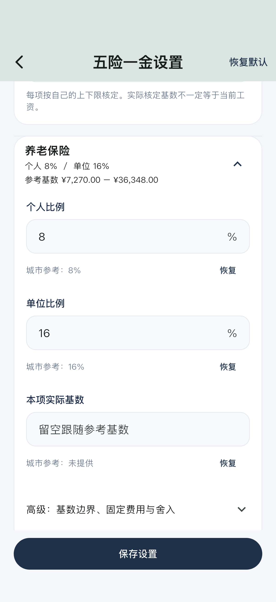
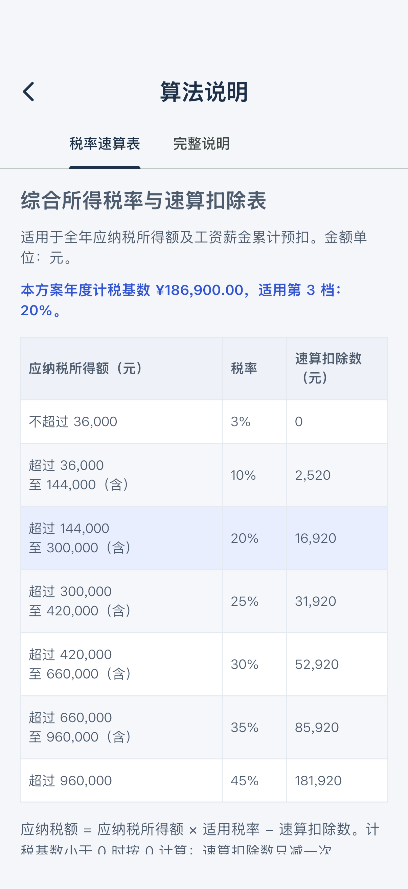

# 薪酬测算

**看懂到手工资，也看清五险一金和不同薪资方案的差别。**

输入城市、月薪和缴费参数，查看全年与每月的收入、扣款和账户缴存；把方案保存下来，就能逐项比较，再生成图片留存或分享。

Android / iOS · 离线测算 · 无需登录 · 方案保存在本机

## 一年的收入，分开看才清楚

结果页把两件事放在最前面：**工资扣完后拿到多少**，以及**加上账户缴存后合计多少**。总额与组成放在同一张卡片里，不用翻到其他位置找扣款或分项。

| 税后年薪：工资扣在哪里 | 年度总收入：由哪些部分组成 |
| --- | --- |
| <a href="screenshots/v2/v2-results.png"></a> | <a href="screenshots/v2/v2-annual-total-income.png"></a> |

| 页面上的金额 | 表示什么 |
| --- | --- |
| **税后年薪 / 税后工资** | 税前工资及奖金，减去个人社保、个人公积金和已预扣个税后的工资现金。 |
| **年度 / 月度总收入** | 税后工资＋公司与个人公积金＋医保个人账户估算＋个人养老保险缴费；年、月口径一致。 |
| **单位总成本** | 单位承担的工资、奖金、单位社保和单位公积金，单独展示。 |

总收入包含账户缴存，**不等于可以直接支取的现金**。社保中的“个人养老保险”与另行自愿缴存的“个人养老金”分开计算和展示；医保账户金额标明为估算。

## 把两份方案放在一起比较

拿到两份薪资方案，或者想看看不同公积金比例的影响，可以分别保存后勾选对比。每份方案会保留计算时的参数和结果，方便之后回看。

- **按项目并列看**：税后收入、含账户缴存的收入、个税、五险一金、单位成本及缴费参数。
- **先全年，再当月**：年度项目在前，月度项目在后；可切换月份查看变化。
- **更快找到差别**：显示金额差额，支持“只看差异”和交换 A / B。
- **保留不同假设**：支持命名保存、复制、重命名或删除，方便管理多个方案。

| 保存方案及其参数 | 两份方案逐项对比 |
| --- | --- |
| <a href="screenshots/v2/v2-plans.png"></a> | <a href="screenshots/v2/v2-comparison.png"></a> |

## 每个月能核对，结果也能带走

从结果页进入“更多月详情”，可以查看 12 个月的税后工资、个税和月度总收入。点击某个月，还能展开个人社保各险种、双方公积金以及累计预扣个税的计算过程。

测算结果和方案对比都可以生成长图。先预览，再选择**保存相册**或**系统分享**；结果图会带上收入拆分、参数配置和 12 个月明细，便于自己留存或与他人讨论。

| 每月收入与四项组成 | 分享前预览 |
| --- | --- |
| <a href="screenshots/v2/v2-months.png"></a> | <a href="screenshots/v2/v2-share-preview.png"></a> |

## 三步开始测算

1. **选择城市，核对缴费参数。** 首次默认北京；城市可按中文、拼音或首字母搜索。选城后带入参考基数范围和比例，也可以手动修改各险种及公积金参数。
2. **填写工资和扣除。** 输入税前月薪，按需补充年终奖、专项附加扣除与个人养老金。符合条件的年终奖可比较单独计税和并入工资两种测算方式。
3. **查看、保存、比较。** 核对参数后开始测算，看全年结果与月详情；需要比较时，将两份结果保存为方案后勾选对比。

<details>
<summary>查看填写参数与五险一金设置截图</summary>

各险种可以分别调整个人 / 单位比例、实际基数、上下限、固定费用与舍入方式。也支持恢复城市参考值或该城市上次调整。

| 填写月薪与城市 | 展开查看养老保险参数 |
| --- | --- |
| <a href="screenshots/v2/v2-home-configured.png"></a> | <a href="screenshots/v2/v2-contributions-expanded.png"></a> |

</details>

## 计算过程看得到

“计算说明”展示年度税后工资、应纳税所得额和个税的公式及对应金额。点击提示图标可查看税率与速算扣除表，并定位本方案所在税档。已预扣个税、年度应纳税估算和可能的汇算差额分别列示。

<details>
<summary>查看累计扣税明细与速算扣除表</summary>

| 累计收入与扣除怎么得到 | 查看税率及速算扣除数 |
| --- | --- |
| <a href="screenshots/v2/v2-month-tax-basis.png"></a> | <a href="screenshots/v2/v2-tax-rates.png"></a> |

</details>

完整口径见 [算法说明](doc/薪酬算法说明.md)。本文图片为当前 App 在 iOS 模拟器中的实际运行截图，可点击查看原图；金额使用演示方案，不代表真实工资记录或已核验的城市政策。

## 使用前了解这些

**城市参数是起点，仍要核对。** 内置 337 条城市参考配置，尚未完成全国完整年度政策核验。请按当地规则和单位实际缴费情况确认；缺失项需补齐。自定义估算会把当前参数用于全年，并在结果中标注。详细状态见 [城市配置说明](doc/改版设计/04-全国城市配置与自动带入方案.md)。

**本版适合全年固定月薪测算。** 当前范围为居民个人、全年同一单位、固定月薪及一笔全年一次性奖金。年中调薪、入离职、多单位及其他综合所得尚不在本版输入范围内。结果用于理解与比较薪酬，不替代工资单或税务申报。

**数据留在本机。** 无需注册或登录，工资、草稿和方案保存在本地，测算可离线完成。相册保存和系统分享由你主动发起；相册权限被拒绝时，可以通过“去设置”调整后再次保存。

## 本地运行

使用 Flutter 3.38.5 / Dart 3.10.4 开发。Android 需要 Android SDK 与 Java 工具链；iOS 需要 macOS、Xcode 与 CocoaPods。

```sh
flutter pub get
flutter run
```

<details>
<summary>开发者：构建、验证与代码目录</summary>

常用检查与构建：

```sh
flutter analyze
flutter test
flutter build apk --debug
flutter build ios --simulator --debug --no-codesign
```

Android 正式构建使用自己的签名配置，参考 [签名配置示例](android/key.properties.example)。从集成测试切换到 Release 构建时，使用普通构建命令，让 Flutter 重新生成对应模式的插件注册文件。

设备端流程与截图使用独立测试数据库，不清空已有方案：

```sh
flutter drive --driver=test_driver/integration_test.dart --target=integration_test/payroll_flow_test.dart -d <simulator-or-emulator-id> --keep-app-running
```

截图写入 `screenshots/v2/`，覆盖填写参数、缴费设置、结果拆分、月详情、算法说明、方案对比与分享。README 使用其中的代表性页面。测试依赖的 SQLite FFI 使用本机系统库。

原生相册专项验证使用不含个人薪资的测试图片；首次运行需要响应系统授权弹窗：

```sh
flutter drive --driver=test_driver/integration_test.dart --target=integration_test/gallery_save_test.dart -d <simulator-or-emulator-id> --keep-app-running
# 在设备设置中拒绝权限后，验证拒绝、取消和再次保存：
flutter drive --driver=test_driver/integration_test.dart --target=integration_test/gallery_save_test.dart -d <simulator-or-emulator-id> --dart-define=GALLERY_EXPECT_DENIED=true --keep-app-running
```

第二条适用于需要相册 / 存储授权的系统。iOS 14 及以上保存分享图仅申请添加照片；iOS 13 使用兼容授权。Android 10 及以下按当前 Gal 2.3.3 的实现申请写入权限，Android 11 及以上通过 MediaStore 保存生成的图片。原生权限配置修改后需重新构建安装，热重载不会生效。

验证完成后，用 `flutter run -t lib/main.dart` 恢复普通应用入口。最新验证结果见 [实现与验证记录](doc/改版设计/05-实现与验证记录.md)。

| 路径 | 内容 |
| --- | --- |
| `lib/domain/` | 整数金额、缴费比例、累计预扣与方案对比 |
| `lib/application/` | 草稿、城市切换、方案与保存状态 |
| `lib/data/` | SQLite、本地迁移与城市参考目录 |
| `lib/features/payroll/` | 测算、结果、方案、分享界面 |
| `lib/calculation/` | 旧版快照兼容模型与格式化工具 |
| `assets/policies/` | 城市参考配置及来源许可 |
| `test/` / `integration_test/` | 算法、迁移、布局与设备端验证 |
| `tool/build_city_catalog.py` | 城市参考目录生成脚本 |

旧 SharedPreferences 数据迁移到 SQLite 时保留原始备份；缺失历史月明细不补算。

</details>

## 更多资料与许可

[产品改版总览](doc/改版设计/00-改版总览.md) · [算法说明](doc/薪酬算法说明.md) · [实现与验证记录](doc/改版设计/05-实现与验证记录.md)

城市参考目录整理自 [city-salary](https://github.com/weante/city-salary) 的 MIT 数据及项目采集底稿，保留来源与许可；参考目录不等于政府发布的政策库。

项目采用 [MIT License](LICENSE)，第三方依赖和参考数据保留各自许可。
